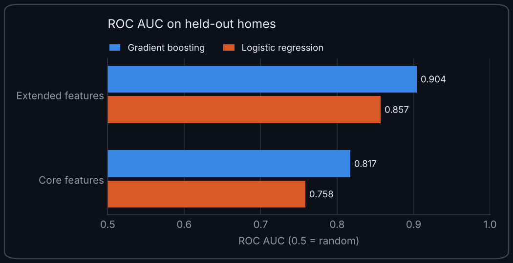
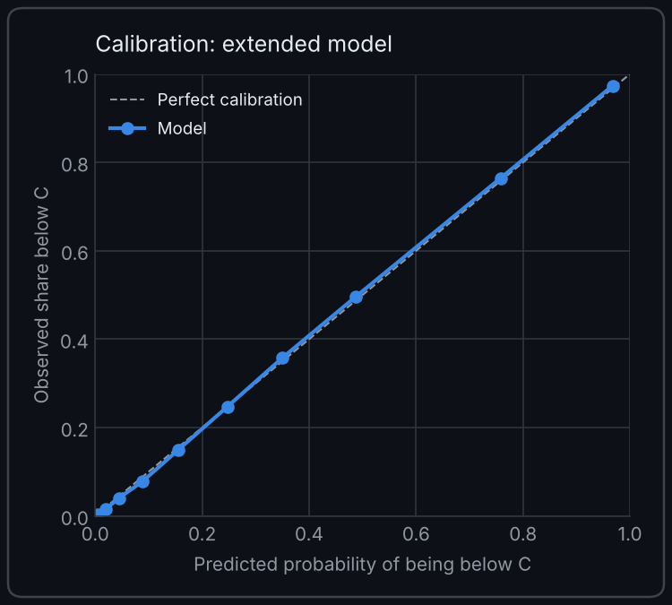
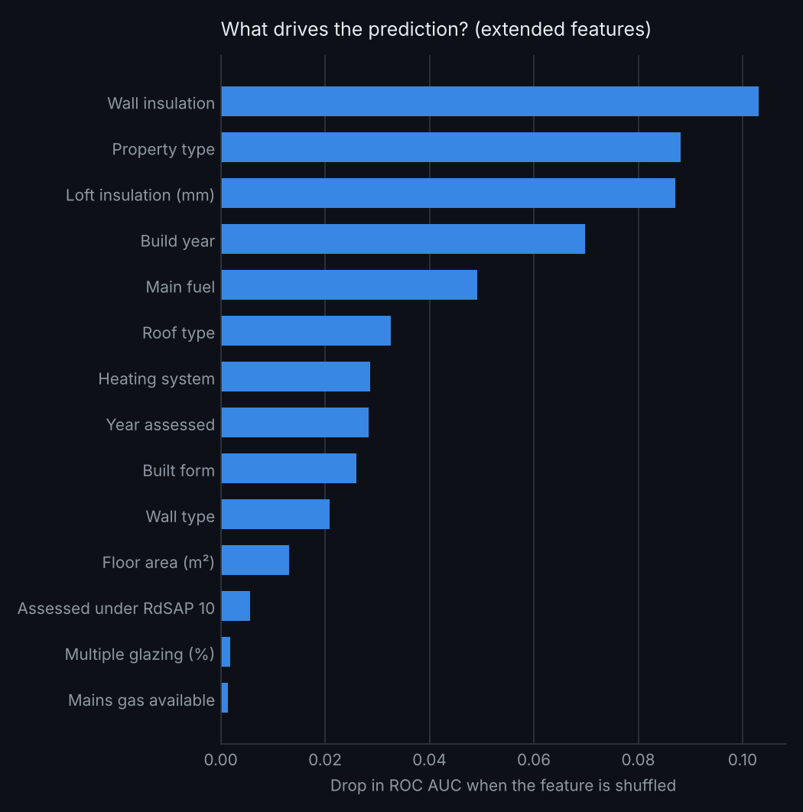
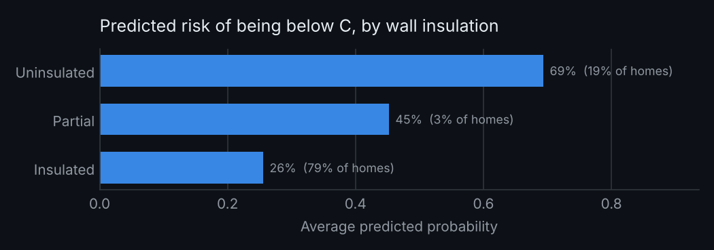
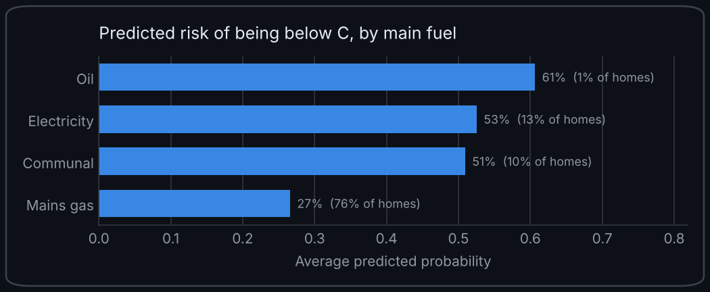
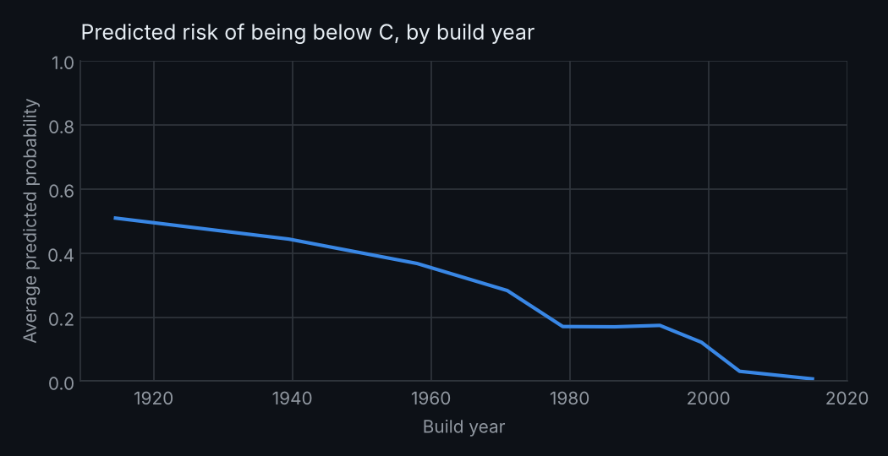
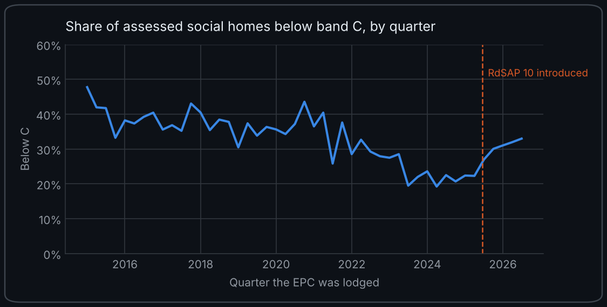

# Which social homes will miss EPC C? Predicting and explaining energy efficiency risk in England's social housing

Social rented homes in England must reach **EPC band C by 1 April 2030**. Landlords need to know which homes are most at risk, but many do not hold up-to-date survey data for every property.

This project uses **136,379 Energy Performance Certificates for social rented homes** in five local authorities (Manchester, Sheffield, Cornwall, Newcastle upon Tyne and Southwark) to answer two questions:

1. **Prediction:** using only what a typical asset register holds (property type, built form, build year, floor area, fuel), how well can we identify homes likely to be below band C? This is the **core** model.
2. **Explanation:** what actually drives the risk, and how much better do we do when we also know about walls, roofs, insulation and heating? This is the **extended** model.

## Headline results

**31% of the social homes in the data (42,646) were rated below band C on their latest certificate (lodged between 2015 and 2026).**

### How well does it predict?



*ROC AUC measures how well a model ranks homes by risk: 0.5 is no better than chance and 1.0 is a perfect ranking. Scores are for homes the model did not see during training.*

- **Asset-register data alone gets you a useful ranking.** The core model reaches a ROC AUC of **0.82**.
- **Survey data adds a lot.** The extended model lifts this to **0.90**, roughly halving the gap to a perfect ranking. This quantifies the value of a stock condition survey.
- **It transfers to areas the model has never seen.** Training on four areas and testing on the fifth gives **0.76** (core) and **0.87** (extended) across all five areas. These are the realistic figures for a landlord applying the model to new stock.
- **Gradient boosting beats logistic regression in every comparison** (0.82 vs 0.76 core, 0.90 vs 0.86 extended). Combinations of features matter, which a linear model cannot fully capture.

<p align="center"></p>

The predicted probabilities are also **well calibrated**: they track observed rates closely, so a predicted 40% risk really does mean roughly 40 in 100 such homes are below C. That makes the scores usable for planning, not just ranking.

### What drives the risk?



Wall insulation is the single strongest signal, followed by property type, loft insulation and build year. The charts below show the model's predicted risk for each group, with other factors held constant.

| Wall insulation | Main fuel | Build year |
|---|---|---|
|  |  |  |

- **Uninsulated walls:** 64% of homes with uninsulated walls are below C, against 23% with insulated walls. Once other factors are held constant, the model's predicted risk is 69% against 26%.
- **Off-gas homes:** homes heated by oil (61%), electricity (53%) or communal systems (51%) have around double the predicted risk of mains gas homes (27%), other factors held constant.
- **Build era:** predicted risk falls steadily from about 50% for pre-1920 homes to almost zero for homes built after 2003, other factors held constant.
- **Houses and bungalows** (39% and 42% below C) are far more likely to be below C than flats (22%), which lose less heat through shared walls, floors and ceilings.

**Highest-risk archetypes with at least 150 homes in the test set:**

| Property type | Build era | Main fuel | Homes | Actual below C | Predicted |
|---|---|---|---|---|---|
| House | 1983-2002 | Electricity | 180 | 79% | 77% |
| House | 1965-82 | Communal | 188 | 62% | 58% |
| Flat | 1945-64 | Electricity | 373 | 58% | 60% |
| House | pre-1919 | Mains gas | 1,584 | 51% | 52% |
| Flat | 1965-82 | Electricity | 830 | 48% | 48% |
| House | 1919-44 | Mains gas | 4,156 | 47% | 46% |

The interwar gas-heated house is not the riskiest archetype, but it is by far the **largest** at-risk group: **9,305 of them are below C** across the full dataset, more than any other archetype. That makes it a natural target for a retrofit programme.

### A methodology change shows up in the data



The share of assessed homes below C fell from around 40% in 2015 to 20% in 2024, then rose again after the assessment method changed to **RdSAP 10 on 15 June 2025**. Holding everything else constant, the model estimates that being assessed under RdSAP 10 adds about **3.4 percentage points** to a home's risk of being below C. Comparing ratings across this change without adjusting for it could make a landlord's stock look worse than it is, so the models include the assessment year and an RdSAP 10 flag as controls.

This chart should not be read as a trend for the whole stock. Each quarter shows the homes that happened to be assessed then (mostly homes being re-let), not a consistent picture of all homes, so extending the line forward would be misleading.

Full numbers are in [`reports/summary.md`](reports/summary.md) and [`reports/metrics.json`](reports/metrics.json).

## What the model is for (and what it isn't)

### How a landlord could use it

- **Find at-risk homes without an up-to-date rating.** Score every home from the asset register, including homes with no EPC or an old one, and survey the highest-risk homes first. The core model is the realistic choice here because it only needs data landlords already hold: it scores 0.82 on held-out homes and 0.76 in areas it has never seen.
- **Size the problem today.** Because the predicted probabilities are well calibrated, adding them up gives an expected count. If 1,000 unrated homes have an average predicted risk of 35%, roughly 350 of them are likely to be below C. That gives a planning and budgeting figure without surveying every home.
- **Target retrofit spending.** Wall insulation, loft insulation and off-gas heating are the strongest drivers of risk, which points to the interventions most likely to move homes over the line.
- **Decide whether a stock condition survey is worth it.** The jump from 0.82 (core) to 0.90 (extended) puts a number on how much better a landlord can target work once they have survey data.

### What it does not do

**It does not forecast how many homes will be below C in 2030.** The model is a snapshot: it estimates how likely a home is to be below C at the time it was assessed, based on its characteristics. It knows nothing about how quickly homes are being improved, so it cannot project the stock forward. A forecast needs improvement rates measured on the same homes over time; see the first item in [Ideas for next steps](#ideas-for-next-steps).

## Data

**Source:** [Get energy performance of buildings data](https://get-energy-performance-data.communities.gov.uk/) (MHCLG). This GOV.UK service replaced the old Open Data Communities EPC portal in 2026.

**Areas used:** Manchester (46,296 homes), Sheffield (38,913), Cornwall (19,863), Newcastle upon Tyne (17,800) and Southwark (13,507). Together they mix large northern cities, an inner London borough and a rural, largely off-gas county. Certificates lodged from January 2015 to September 2026, latest certificate per home.

**Reproducing it**

1. Sign in with GOV.UK One Login on the service above and download domestic EPC certificate data.
2. The downloads are large (over 1GB for a couple of local authorities), so shrink them first:
   ```bash
   python scripts/extract_subset.py path/to/download.csv          # default areas
   python scripts/extract_subset.py path/to/download.zip --areas E08000003 E09000028
   ```
   This keeps social rented homes since 2015, keeps the latest certificate per home, drops addresses and writes a small `epc_social_subset.csv.gz`.
3. Put that file (or the raw CSVs) anywhere under `data/raw/` and run the pipeline.

Raw data is git-ignored and never committed. Check the service's licensing guidance before redistributing any derived data.

**If a column name has changed:** the pipeline normalises column names automatically. If it reports a missing column, add the new name to `ALIASES` in `src/housing_epc/columns.py`.

## Method

| Step | What happens | Where |
|---|---|---|
| Load | Stream CSVs in chunks, keep social rented tenure and certificates lodged since 2015 | `load.py` |
| Deduplicate | Keep the latest certificate per home (UPRN, falling back to address and postcode) | `features.py` |
| Features | Parse age bands, fuel, wall type and insulation, roof and loft depth, heating system, glazing | `features.py` |
| Target | `below_c` = current rating D, E, F or G | `config.py` |
| Models | Logistic regression baseline and histogram gradient boosting, on **core** and **extended** feature sets | `model.py` |
| Validation | Stratified 80/20 held-out test set, plus leave-one-local-authority-out cross-validation | `model.py` |
| Explanation | Permutation importance, partial dependence, SHAP values (optional), archetype and area tables | `explain.py` |

### Feature sets

- **Core (asset register):** property type, built form, build year, floor area, main fuel, mains gas availability
- **Extended (stock survey):** core plus wall type, wall insulation, roof type, loft insulation depth, heating system, multiple glazing percentage
- **Controls (both sets):** year the EPC was lodged and whether it was assessed under RdSAP 10. To score a home as if assessed today, set these to the current date.

### Avoiding leakage

An EPC rating is calculated from the certificate's own inputs. Feeding the model fields such as the SAP score, running costs, CO₂ or the per-element efficiency ratings would let it reverse-engineer the formula and report a meaningless near-perfect score. These are listed in `LEAKAGE_COLUMNS` and excluded, and a test checks they never reach the feature table.

### Checking the controls are not a back door

Landlords often commission EPCs in large batches, so assessment dates could act as a proxy for area and inflate the scores. To test this, the models were rerun without the date controls. The controls improve performance on unseen areas too (core: 0.740 without, 0.757 with), so they capture genuine time effects rather than identifying the area.

## Running it

```bash
python -m venv .venv
source .venv/bin/activate            # Windows: .venv\Scripts\activate
pip install -e ".[shap,dev]"

python -m housing_epc.pipeline                    # full run on data/raw (about 2 minutes for 136k homes)
python -m housing_epc.pipeline --sample 200000    # random subsample for very large inputs
python -m housing_epc.pipeline --theme light      # light charts instead of the default dark
pytest                                            # unit tests
```

Charts default to a dark theme that matches GitHub's dark mode.

**No data yet?** Generate a synthetic file to check everything runs (its numbers are invented, never publish them):

```bash
python scripts/make_synthetic_data.py --rows 30000
python -m housing_epc.pipeline --raw data/synthetic
```

## Outputs

| File | Contents |
|---|---|
| `reports/summary.md` | Plain-English results summary |
| `reports/metrics.json` | All metrics, including each leave-one-area-out fold |
| `reports/figures/00_below_c_over_time.png` | Share below C by quarter, with RdSAP 10 marked |
| `reports/figures/01_feature_set_comparison.png` | Core vs extended, logistic vs boosting |
| `reports/figures/02_calibration_extended.png` | Are predicted probabilities trustworthy? |
| `reports/figures/03_importance_*.png` | Permutation importance |
| `reports/figures/04_pdp_*.png` | How risk changes with build year, fuel, insulation and more |
| `reports/figures/05_*`, `06_*` | SHAP importance and dependence (generated when `shap` is installed) |
| `reports/archetype_risk.csv` | Risk by property type, build era and fuel |
| `reports/local_authority_gap.csv` | Observed vs expected below-C share by area |

## Project structure

```
├── data/
│   ├── raw/                    # EPC downloads go here (git-ignored)
│   └── processed/              # cleaned modelling table (git-ignored)
├── notebooks/
│   └── 01_explore.ipynb        # exploratory analysis of the cleaned table
├── reports/                    # metrics, tables and figures
├── scripts/
│   ├── extract_subset.py       # shrink large downloads to an address-free subset
│   └── make_synthetic_data.py  # synthetic data for testing
├── src/housing_epc/
│   ├── config.py               # settings, feature sets, leakage list
│   ├── columns.py              # column-name normalisation
│   ├── load.py                 # chunked loading and tenure filter
│   ├── features.py             # cleaning and feature engineering
│   ├── model.py                # training and validation
│   ├── explain.py              # importance, partial dependence, SHAP, tables
│   └── pipeline.py             # end-to-end command line entry point
└── tests/
```

## Limitations

- **Five areas, not all of England:** results describe these five local authorities. They span very different stock, and the leave-one-area-out results suggest the model transfers reasonably, but national figures would need the full dataset.
- **Coverage:** only homes with a certificate are included. Most social homes have one because an EPC is needed to let a property, but recently let or recently surveyed homes may be over-represented.
- **Certificates age:** a certificate describes the home when it was assessed. Improvements made since then are not captured.
- **"Assumed" values:** where an assessor cannot see insulation, RdSAP assumes it from the build era. Some wall and roof insulation values are therefore defaults rather than observations.
- **Explanation is not causation:** importance and partial dependence describe what the model learned. They point to where to look, not to proof that changing one feature will change a rating.

## Ideas for next steps

- **Forecast the position in 2030.** Homes with more than one certificate show how often ratings improve, for example how many D-rated homes become C each year and how that varies by archetype. Combining those rates with the model's risk scores would give a projection to April 2030 under scenarios such as "current pace of improvement" against "planned retrofit programme". Homes that get reassessed are not a random sample, and the RdSAP 10 change affects comparisons across mid-2025, so both would need handling.
- Scale up to the full national dataset and compare regions.
- Join deprivation data (Index of Multiple Deprivation via postcode to LSOA): are the highest-risk homes concentrated in the most deprived areas?
- Use the recommendations file to estimate the cost of bringing each archetype up to band C.
- Predict the SAP score directly (regression) to rank homes by how far they are from C.
- Link to the English Housing Survey to explore whether low energy efficiency is associated with damp and mould.

## Licence

Code: MIT (see `LICENSE`). EPC data: subject to MHCLG's licence terms.
