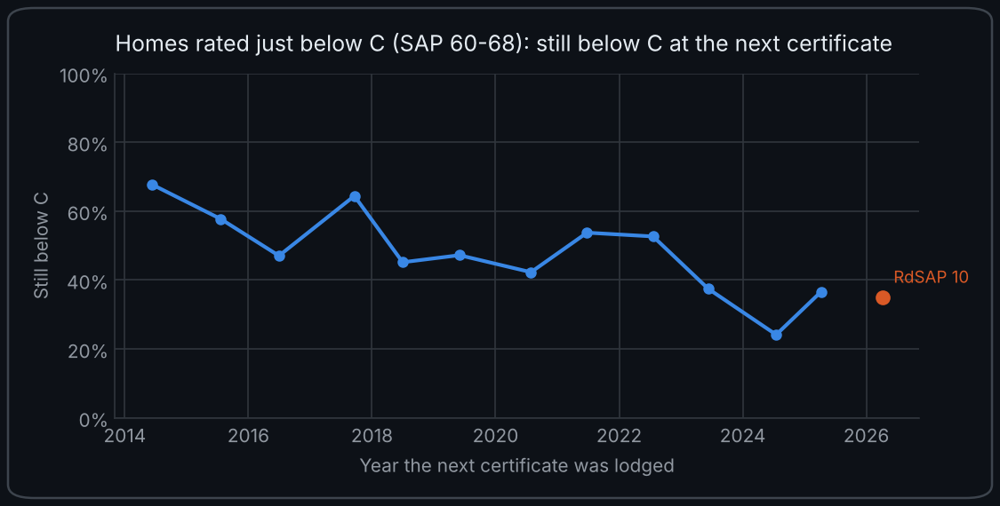
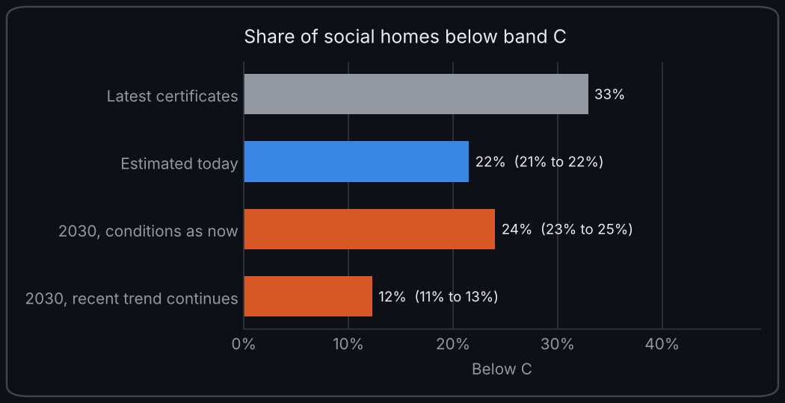
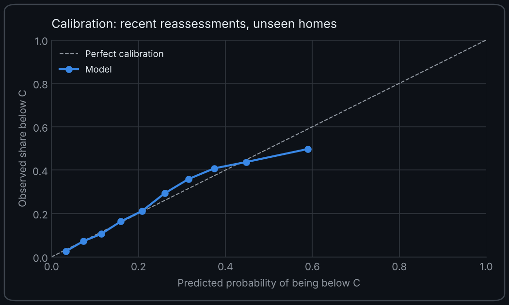

# Which social homes will miss EPC C? Predicting, explaining and forecasting energy efficiency risk in England's social housing

Social rented homes in England must reach **EPC band C by 1 April 2030**. Landlords need to know which homes are most at risk, but many do not hold up-to-date survey data for every property.

This project uses Energy Performance Certificates for social rented homes in five local authorities (Manchester, Sheffield, Cornwall, Newcastle upon Tyne and Southwark) to answer three questions:

1. **Prediction:** using only what a typical asset register holds (property type, built form, build year, floor area, fuel), how well can we identify homes likely to be below band C? This is the **core** model.
2. **Explanation:** what actually drives the risk, and how much better do we do when we also know about walls, roofs, insulation and heating? This is the **extended** model.
3. **Forecast:** using homes that have been assessed more than once, how many are likely to be below C today, and on 1 April 2030? See [Forecasting the position in 2030](#forecasting-the-position-in-2030).

All three are then repeated for **3 million social homes across England**, with results by region: see [Scaling up to all of England](#scaling-up-to-all-of-england).

## At a glance

- **Prediction:** asset-register data alone ranks homes by risk with a ROC AUC of **0.82** (0.80 across England, where 1.0 is a perfect ranking). Adding stock survey data lifts this to **0.90**.
- **Explanation:** uninsulated walls, off-gas heating, older homes and houses rather than flats drive the risk. Wall insulation is the strongest single signal.
- **Today:** scored as if reassessed now, about **one in five** social homes is likely to be below C, not the one in three their latest certificates suggest. Across England that is about **600,000 homes**.
- **2030:** on current evidence the deadline will be missed. Even if the recent improvement trend continues, around **10% of England's social homes (about 310,000)** would still be below C in April 2030.

## Predicting and explaining the risk (five areas)

**31% of the social homes in the data (42,646) were rated below band C on their latest certificate (lodged between 2015 and 2026).**

### How well does it predict?


*ROC AUC measures how well a model ranks homes by risk: 0.5 is no better than chance and 1.0 is a perfect ranking. Scores are for homes the model did not see during training.*

- **Asset-register data alone gets you a useful ranking.** The core model reaches a ROC AUC of **0.82**.
- **Survey data adds a lot.** The extended model lifts this to **0.90**, roughly halving the gap to a perfect ranking. This quantifies the value of a stock condition survey.
- **It transfers to areas the model has never seen.** Training on four areas and testing on the fifth gives **0.76** (core) and **0.87** (extended) across all five areas. These are the realistic figures for a landlord applying the model to new stock.
- **Gradient boosting beats logistic regression in every comparison** (0.82 vs 0.76 core, 0.90 vs 0.86 extended). Combinations of features matter, which a linear model cannot fully capture.


The predicted probabilities are also **well calibrated**: they track observed rates closely, so a predicted 40% risk really does mean roughly 40 in 100 such homes are below C. That makes the scores usable for planning, not just ranking.

### What drives the risk?


Wall insulation is the single strongest signal, followed by property type, loft insulation and build year. The charts below show the model's predicted risk for each group, with other factors held constant.

| Wall insulation | Main fuel | Build year |
|---|---|---|
|  |  |  |

- **Uninsulated walls:** 64% of homes with uninsulated walls are below C, against 23% with insulated walls. Once other factors are held constant, the model's predicted risk is 69% against 26%.
- **Off-gas homes:** homes heated by oil (61%), electricity (53%) or communal systems (51%) have around double the predicted risk of mains gas homes (27%), other factors held constant.
- **Build era:** predicted risk falls steadily from about 50% for pre-1920 homes to almost zero for homes built after 2003, other factors held constant.
- **Houses and bungalows** (39% and 42% below C) are far more likely to be below C than flats (22%), which lose less heat through shared walls, floors and ceilings.

**Highest-risk archetypes with at least 150 homes in the test set:**

| Property type | Build era | Main fuel | Homes | Actual below C | Predicted |
|---|---|---|---|---|---|
| House | 1983-2002 | Electricity | 180 | 79% | 77% |
| House | 1965-82 | Communal | 188 | 62% | 58% |
| Flat | 1945-64 | Electricity | 373 | 58% | 60% |
| House | pre-1919 | Mains gas | 1,584 | 51% | 52% |
| Flat | 1965-82 | Electricity | 830 | 48% | 48% |
| House | 1919-44 | Mains gas | 4,156 | 47% | 46% |

The interwar gas-heated house is not the riskiest archetype, but it is by far the **largest** at-risk group: **9,305 of them are below C** across the full dataset, more than any other archetype. That makes it a natural target for a retrofit programme.

### A methodology change shows up in the data


The share of assessed homes below C fell from around 40% in 2015 to 20% in 2024, then rose again after the assessment method changed to **RdSAP 10 on 15 June 2025**. Holding everything else constant, the model estimates that being assessed under RdSAP 10 adds about **3.4 percentage points** to a home's risk of being below C. Comparing ratings across this change without adjusting for it could make a landlord's stock look worse than it is, so the models include the assessment year and an RdSAP 10 flag as controls.

This chart should not be read as a trend for the whole stock. Each quarter shows the homes that happened to be assessed then (mostly homes being re-let), not a consistent picture of all homes, so extending the line forward would be misleading. The [forecast](#forecasting-the-position-in-2030) looks forward properly, by following the same homes from one certificate to the next.

Full numbers are in [`reports/summary.md`](reports/summary.md) and [`reports/metrics.json`](reports/metrics.json).

## Forecasting the position in 2030

The models above are a snapshot. To look forward, the forecast uses homes that have been assessed more than once. It goes back further than the classifier, to certificates lodged from 2012, so it covers more homes in the same five areas: **208,473 certificates for 156,256 homes**, of which 41,521 have two or more, giving 37,613 usable pairs of consecutive certificates on the same home.

### What repeat certificates show



- **A single certificate is a noisy reading.** Low scores tend to rise and high scores tend to fall at the next certificate, whatever the gap: partly assessor variation, partly "before" certificates lodged ahead of retrofit work. **35% of homes have a latest SAP score within 3 points of the C line** (66 to 71), where one reassessment can tip them either way.
- **When a home is reassessed matters more than how long since its last certificate.** For homes rated just below C, the share still below C at the next certificate was between about 40% and 70% up to 2022, then fell to 24% for certificates lodged in 2024. It is 35% under RdSAP 10, which scores the same home a little lower.
- **The national picture shows the same shift.** The [English Housing Survey](https://www.gov.uk/government/statistics/chapters-for-english-housing-survey-2024-to-2025-headline-findings-on-housing-quality-and-energy-efficiency/introduction-and-key-findings) found band D fell from 43% to 35% of all homes in England between 2022 and 2024.

### The forecast



| Position | Expected homes below C | Share |
|---|---|---|
| Latest certificates, taken at face value | 51,413 | 32.9% |
| Estimated today (October 2026) | 33,623 | 21.5% (20.8% to 22.1%) |
| 1 April 2030, conditions as now | 37,547 | 24.0% (23.3% to 24.6%) |
| 1 April 2030, recent trend continues | 19,176 | 12.3% (11.4% to 12.9%) |

*Ranges are 90% intervals from refitting the model on resampled homes. They cover uncertainty in the fit, not in which scenario holds. The latest-certificate share (33%) is a little above the 31% earlier because it also counts homes whose latest certificate is from 2012 to 2014.*

- **Latest certificates overstate the problem.** Many are a decade old. Scored as if reassessed today, about one in five homes is likely to be below C, not one in three.
- **On current evidence, the deadline will be missed.** Clearing every below-C home by April 2030 means about **9,800 fewer below-C homes a year**. Even if the recent improvement trend continues, the fall is about **4,200 a year**, leaving around 12% of homes below C.
- **The pace matches national data.** The English Housing Survey shows social rented homes below C falling by about 2 percentage points a year ([30% in 2022, 26% in 2024](https://www.gov.uk/government/statistics/chapters-for-english-housing-survey-2024-to-2025-headline-findings-on-housing-quality-and-energy-efficiency/chapter-2-energy-efficiency)), close to the "trend continues" scenario.
- **The biggest group is unchanged.** Interwar gas-heated houses are still the largest at-risk archetype: about 7,000 likely to be below C today, and about 4,100 in 2030 even if the trend continues.

| Area | Homes | Below C today | 2030, trend continues |
|---|---|---|---|
| Manchester | 51,989 | 18.2% | 9.9% |
| Southwark | 19,175 | 21.2% | 11.6% |
| Sheffield | 42,904 | 22.5% | 13.1% |
| Cornwall | 21,505 | 23.0% | 14.0% |
| Newcastle upon Tyne | 20,683 | 26.6% | 15.5% |

Full numbers are in [`reports/forecast_summary.md`](reports/forecast_summary.md), with tables by area and archetype alongside.

### How it works

For each pair of consecutive certificates, a logistic regression predicts whether the later one is below C from the earlier certificate's **SAP score** (a D at 68 is a near miss, a D at 56 is not), the gap between them, whether the earlier certificate was lodged because of works, property type, build era, fuel, area, and the **period** the later certificate was lodged in (each year, with RdSAP 10 as a period of its own). Pairs whose later certificate was itself lodged because of works (ECO, grant schemes) are left out, so the model describes a routine reassessment.

Every home is then scored from its latest certificate as if reassessed under current conditions. "Conditions as now" holds the period effect at its RdSAP 10 level until April 2030; "recent trend continues" lets it keep falling at its 2019 to 2025 pace.

A first version assumed homes improve steadily over time (a two-state Markov chain). It failed its backtest because, as above, the time between certificates barely matters while the calendar year matters a lot.



**Checks.** On recent reassessments of homes the model never saw, it predicts 25.8% below C against 25.7% observed. Its Brier score (the average squared error of its probabilities, lower is better) is 0.168, against 0.366 for assuming each home keeps its band. Fitted only on data to 2022, it would have predicted 29.6% below C for 2023 to mid-2025 against 23.9% observed: it could not have seen the 2023 shift coming, which is why 2030 is shown as scenarios rather than one number.

### Caveats

- **The "today" figure may be optimistic.** Landlords often lodge a routine-looking certificate after works, so recently reassessed homes may be better than the stock as a whole. The model shows a sign of this: at the same starting score, a home reassessed soon after a low rating is less likely to still be below C than one reassessed years later, which is also why "conditions as now" sits a little above "today". The 21.5% estimate is below the national 26% for 2024, though these five areas may simply be ahead.
- **Real improvement and assessment practice cannot be separated.** The period effects capture both.
- **The trend scenario is an extrapolation.** Nothing in the data says the 2019 to 2025 pace will hold.
- **Compliance is not just the current rating.** Under the [confirmed policy](https://www.elmhurstenergy.co.uk/blog/2026/02/03/social-rented-homes-to-reach-epc-c-by-1st-april-2030/), homes can comply through new fabric, heating or smart-readiness metrics, and a £10,000 spend cap allows deferral. This forecast is about the current EPC rating only.

## Scaling up to all of England

The same code runs on the full national download: **4.1 million certificates for 3.0 million social rented homes** across all 296 English local authorities. Welsh authorities are in the download but left out, because Wales sets its own standard for social housing. Results are in [`reports/england/`](reports/england/).

### The model holds up nationally

| ROC AUC | Five areas | England |
|---|---|---|
| Core model, held-out homes | 0.82 | 0.80 |
| Extended model, held-out homes | 0.90 | 0.90 |
| Core model, area never seen in training | 0.76 | 0.79 (0.77 to 0.81) |
| Extended model, area never seen in training | 0.87 | 0.89 (0.85 to 0.91) |

*Nationally, "area never seen" means training on eight regions and testing on the ninth; the range is across the nine regions. For the five areas it means leaving out one local authority at a time.*

The core model loses a little accuracy on a far more varied stock; the extended model does not. Training on eight regions and testing on the ninth works for every region, so a landlord anywhere in England could use it. The drivers are the same: wall insulation, property type, loft insulation and build year.

Nationally, the riskiest archetypes are off-gas homes: oil-heated houses built between 1919 and 1964 (86% to 92% below C) and electrically heated homes of most ages ([table](reports/england/archetype_risk.csv)). By number, the interwar gas-heated house is still the biggest problem, with about 84,000 likely to be below C today.

### Regions


Comparing each region's share below C with what its housing stock alone would predict shows where homes do better or worse than their age, type and fuel suggest. **London's social homes are more likely to be below C than its stock mix predicts (37% against 31%)**, as are the West Midlands and Yorkshire and The Humber. The North West does best against expectation (28% against 32%). These shares are from each home's latest certificate in the held-out test set, so, like any latest-certificate figure here, they overstate the position today.

### The 2030 forecast for England


| Position | Expected homes below C | Share |
|---|---|---|
| Latest certificates, taken at face value | 1,028,056 | 33.9% |
| Estimated today (October 2026) | 607,325 | 20.0% (20.0% to 20.2%) |
| 1 April 2030, conditions as now | 670,500 | 22.1% (22.0% to 22.3%) |
| 1 April 2030, recent trend continues | 310,393 | 10.2% (10.1% to 10.5%) |

- **About 600,000 English social homes are likely to be below C today**, around one in five. Yorkshire and The Humber (26%) and London (23%) have the highest shares; the North West and South East (17%) the lowest.
- **The national pace falls short too.** Clearing every below-C home by April 2030 needs about **177,000 fewer a year**; the recent trend gives about **86,000**, half the pace needed, leaving around 310,000 homes below C.
- **It is consistent with the national survey.** The English Housing Survey found 26% of social rented homes below C in 2024, falling about 2 points a year, which would put 2026 at roughly 22%. This estimate of 20% is slightly lower, in line with the caveat above that recent reassessments may flatter the stock.
- **The model checks out at scale.** On 457,000 recent reassessments of homes it had not seen, it predicts 27.5% below C against 27.5% observed.
- **Coverage:** homes without a certificate lodged since 2012 are not included.

The 2023 shift is even clearer nationally: for homes just below C, the share still below C at the next certificate was between about 50% and 70% every year to 2022, then fell to 32% in 2024 ([chart](reports/england/figures/07_near_line_by_year.png)).

## What the project is for (and what it isn't)

### How a landlord could use it

- **Find at-risk homes without an up-to-date rating.** Score every home from the asset register, including homes with no EPC or an old one, and survey the highest-risk homes first. The core model is the realistic choice here because it only needs data landlords already hold: it scores 0.82 on held-out homes and 0.76 in areas it has never seen (0.80 and 0.79 across England).
- **Size the problem today.** For homes with no certificate, the classifier's probabilities are well calibrated, so adding them up gives an expected count: if 1,000 unrated homes have an average predicted risk of 35%, roughly 350 are likely to be below C. For homes with an old certificate, the forecast's "estimated today" is the better figure, because it allows for improvements since the home was last assessed. That is why it finds one in five homes below C rather than one in three.
- **Prioritise reassessment.** About a third of homes have a latest SAP score within 3 points of the C line. A fresh assessment, or small works such as topping up loft insulation, could move many of them over it, so they are a quick way to cut the number below C.
- **Target retrofit spending.** Wall insulation, loft insulation and off-gas heating are the strongest drivers of risk, which points to the interventions most likely to move homes over the line.
- **Decide whether a stock condition survey is worth it.** The jump from 0.82 (core) to 0.90 (extended) puts a number on how much better a landlord can target work once they have survey data.
- **Plan the programme to 2030.** The forecast gives an expected number of homes below C today and in April 2030 for each area and archetype, under "conditions as now" and "recent trend continues", which brackets the size of the job.

### What it does not do

- **It does not decide compliance.** The confirmed policy allows other routes to compliance and a spend cap (see [Caveats](#caveats)). This project models the current EPC rating only.
- **It does not predict 2030.** The forecast shows two scenarios. The data cannot say whether the recent pace of improvement will hold, slow or speed up.
- **It cannot separate real improvement from changes in assessment.** Ratings shifted sharply around 2023; retrofit programmes, changes in assessment practice and the move to RdSAP 10 all show up together.
- **It is for ranking and counting, not labelling one home.** Two assessments of the same home can differ by several SAP points, so for a home near the line a single prediction is close to a coin toss. The scores are most useful added up across a stock, or used to decide which homes to look at first.

## Data

**Source:** [Get energy performance of buildings data](https://get-energy-performance-data.communities.gov.uk/) (MHCLG). This GOV.UK service replaced the old Open Data Communities EPC portal in 2026.

**Areas used:** Manchester (46,296 homes), Sheffield (38,913), Cornwall (19,863), Newcastle upon Tyne (17,800) and Southwark (13,507). Together they mix large northern cities, an inner London borough and a rural, largely off-gas county. The classifier uses certificates lodged from January 2015 to September 2026, latest certificate per home; the forecast also uses earlier certificates, back to 2012. The England results cover all 296 English local authorities.

**Reproducing it**

1. Sign in with GOV.UK One Login on the service above and download domestic EPC certificate data.
2. The downloads are large (over 1GB for a couple of local authorities), so shrink them first:
   ```bash
   python scripts/extract_subset.py path/to/download.csv          # eight large areas by default (DEFAULT_AREAS)
   python scripts/extract_subset.py path/to/download.zip --areas E08000003 E09000028
   ```
   This keeps social rented homes since 2015, keeps the latest certificate per home, drops addresses and writes a small `epc_social_subset.csv.gz`.
3. Put that file (or the raw CSVs) anywhere under `data/raw/` and run the pipeline.
4. For the 2030 forecast, run the same script with `--history`. This keeps every social rented certificate for each home, plus the SAP score and the reason the certificate was lodged, and links them with an anonymous `home_id` (a hash with a random salt that is never saved, so it cannot be traced back to an address):
   ```bash
   python scripts/extract_subset.py path/to/download.csv --history --areas E08000003 E08000039 E06000052 E08000021 E09000028
   ```
   Put the output in `data/history/`. Current EPC downloads use E08000039 for Sheffield (ONS lookups use E08000019).
5. For England, run it on the national download (an 8GB zip) with `--all-areas`. In history mode it writes as it reads, so it needs little memory, and the output (about 190MB) feeds both the classifier and the forecast:
   ```bash
   python scripts/extract_subset.py all-domestic-csv.zip --history --all-areas --out epc_social_history_england.csv.gz
   ```
   Put the output in `data/england/`. For results by region, save the ONS [Local Authority District to Region lookup](https://www.data.gov.uk/dataset/3fbe9109-f329-4c4a-85cb-3b78ea4fbce3/local-authority-district-to-region-december-2024-lookup-in-en) as `data/lookups/lad_to_region.csv` (a copy is included; Open Government Licence).

Raw data is git-ignored and never committed. Check the service's licensing guidance before redistributing any derived data.

**If a column name has changed:** the pipeline normalises column names automatically. If it reports a missing column, add the new name to `ALIASES` in `src/housing_epc/columns.py`.

## Method

| Step | What happens | Where |
|---|---|---|
| Load | Stream CSVs in chunks, keep social rented tenure and certificates lodged since 2015 | `load.py` |
| Deduplicate | Keep the latest certificate per home (the anonymous `home_id` of a `--history` extract, or UPRN, falling back to address and postcode) | `features.py` |
| Features | Parse age bands, fuel, wall type and insulation, roof and loft depth, heating system, glazing | `features.py` |
| Target | `below_c` = current rating D, E, F or G | `config.py` |
| Models | Logistic regression baseline and histogram gradient boosting, on **core** and **extended** feature sets | `model.py` |
| Validation | Stratified 80/20 held-out test set, plus leave-one-local-authority-out cross-validation (leave-one-region-out for England) | `model.py` |
| Explanation | Permutation importance, partial dependence, SHAP values (optional), archetype and area tables | `explain.py` |
| Forecast | Pairs of consecutive certificates per home, logistic regression with period effects, scenarios to April 2030 | `forecast.py` |

### Feature sets

- **Core (asset register):** property type, built form, build year, floor area, main fuel, mains gas availability
- **Extended (stock survey):** core plus wall type, wall insulation, roof type, loft insulation depth, heating system, multiple glazing percentage
- **Controls (both sets):** year the EPC was lodged and whether it was assessed under RdSAP 10. To score a home as if assessed today, set these to the current date.

### Avoiding leakage

An EPC rating is calculated from the certificate's own inputs. Feeding the model fields such as the SAP score, running costs, CO₂ or the per-element efficiency ratings would let it reverse-engineer the formula and report a meaningless near-perfect score. These are listed in `LEAKAGE_COLUMNS` and excluded, and a test checks they never reach the feature table.

### Checking the controls are not a back door

Landlords often commission EPCs in large batches, so assessment dates could act as a proxy for area and inflate the scores. To test this, the models were rerun without the date controls. The controls improve performance on unseen areas too (five areas, core model: 0.740 without, 0.757 with), so they capture genuine time effects rather than identifying the area.

## Running it

```bash
python -m venv .venv
source .venv/bin/activate            # Windows: .venv\Scripts\activate
pip install -e ".[shap,dev]"

python -m housing_epc.pipeline                    # full run on data/raw (about 2 minutes for 136k homes)
python -m housing_epc.pipeline --sample 200000    # random subsample for very large inputs
python -m housing_epc.pipeline --theme light      # light charts instead of the default dark
python -m housing_epc.forecast --history data/history   # 2030 forecast from a --history extract
pytest                                            # unit tests

# England: put the national --history extract in data/england (about 45 minutes and 4GB of memory in total)
python -m housing_epc.pipeline --raw data/england --england-only --no-shap --reports reports/england
python -m housing_epc.forecast --history data/england --england-only --bootstrap 10 --reports reports/england
```

Charts default to a dark theme that matches GitHub's dark mode.

**No data yet?** Generate a synthetic file to check everything runs (its numbers are invented, never publish them):

```bash
python scripts/make_synthetic_data.py --rows 30000
python -m housing_epc.pipeline --raw data/synthetic

python scripts/make_synthetic_data.py --history --rows 20000
python scripts/extract_subset.py data/synthetic_history --history --all-areas --out data/synthetic_history.csv.gz
python -m housing_epc.forecast --history data/synthetic_history.csv.gz --reports data/synthetic_reports
```

## Outputs

| File | Contents |
|---|---|
| `reports/summary.md` | Plain-English results summary |
| `reports/metrics.json` | All metrics, including each leave-one-area-out fold |
| `reports/figures/00_below_c_over_time.png` | Share below C by quarter, with RdSAP 10 marked |
| `reports/figures/01_feature_set_comparison.png` | Core vs extended, logistic vs boosting |
| `reports/figures/02_calibration_extended.png` | Are predicted probabilities trustworthy? |
| `reports/figures/03_importance_*.png` | Permutation importance |
| `reports/figures/04_pdp_*.png` | How risk changes with build year, fuel, insulation and more |
| `reports/figures/05_*`, `06_*` | SHAP importance and dependence (generated when `shap` is installed) |
| `reports/archetype_risk.csv` | Risk by property type, build era and fuel |
| `reports/local_authority_gap.csv` | Observed vs expected below-C share by area |
| `reports/forecast_summary.md` | 2030 forecast: scenarios, checks and period effects |
| `reports/forecast_2030.json` | All forecast numbers, including backtests |
| `reports/forecast_by_area.csv`, `forecast_by_archetype.csv` | Expected homes below C today and in 2030 |
| `reports/figures/07_*`, `08_*`, `09_*` | Repeat certificates by year, forecast scenarios, forecast calibration |
| `reports/england/` | All of the above for England (except SHAP), plus `region_gap.csv`, `forecast_by_region.csv` and charts `10_*` and `11_*` by region |

## Project structure

```
├── data/
│   ├── raw/                    # EPC downloads go here (git-ignored)
│   ├── history/                # --history extracts for the forecast (git-ignored)
│   ├── england/                # national --history extract (git-ignored)
│   ├── lookups/                # ONS local authority to region lookup
│   └── processed/              # cleaned modelling table (git-ignored)
├── notebooks/
│   └── 01_explore.ipynb        # exploratory analysis of the cleaned table
├── reports/                    # metrics, tables and figures (five areas)
│   └── england/                # the same for all of England, plus regions
├── scripts/
│   ├── extract_subset.py       # shrink large downloads to an address-free subset
│   └── make_synthetic_data.py  # synthetic data for testing
├── src/housing_epc/
│   ├── config.py               # settings, feature sets, leakage list
│   ├── columns.py              # column-name normalisation
│   ├── load.py                 # chunked loading and tenure filter
│   ├── features.py             # cleaning and feature engineering
│   ├── model.py                # training and validation
│   ├── explain.py              # importance, partial dependence, SHAP, tables
│   ├── forecast.py             # 2030 forecast from repeat certificates
│   └── pipeline.py             # end-to-end command line entry point
└── tests/
```

## Limitations

- **Coverage:** only homes with a certificate are included: 3.0 million English social homes with one lodged since 2012. Most social homes have one because an EPC is needed to let a property, but recently let or recently surveyed homes may be over-represented. Welsh homes are excluded.
- **Reassessed homes are not a random sample.** The forecast learns how ratings change from homes that were assessed again, and some of those were reassessed because work had just been done. This may make the "today" figure optimistic (see [Caveats](#caveats)).
- **Certificates age:** the classifier describes each home as it was when assessed. The forecast adjusts for change since then, but only through the year effects it learns from reassessed homes.
- **"Assumed" values:** where an assessor cannot see insulation, RdSAP assumes it from the build era. Some wall and roof insulation values are therefore defaults rather than observations.
- **Regional gaps are not a league table.** The gap between a region's share below C and what its stock mix predicts can reflect things the model does not see, such as how recently and how often landlords re-certify their homes.
- **Explanation is not causation:** importance and partial dependence describe what the model learned. They point to where to look, not to proof that changing one feature will change a rating.

## Ideas for next steps

- Add a "planned retrofit programme" scenario to the forecast, for example a landlord's own works list scored home by home.
- Join deprivation data (Index of Multiple Deprivation via postcode to LSOA): are the highest-risk homes concentrated in the most deprived areas?
- Use the recommendations file to estimate the cost of bringing each archetype up to band C.
- Predict the SAP score directly (regression) to rank homes by how far they are from C.
- Link to the English Housing Survey to explore whether low energy efficiency is associated with damp and mould.

## Licence

Code: MIT (see `LICENSE`). EPC data: subject to MHCLG's licence terms. Region lookup: ONS, Open Government Licence.
